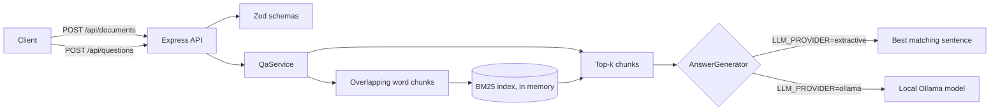

# rag-document-qa

[](https://github.com/Ramvilla1997/rag-document-qa/actions/workflows/ci.yml)

Ask questions about your own documents and get answers that cite the passage they came from.

Upload text documents, and the service splits them into overlapping chunks, ranks chunks against each question with BM25, and returns an answer with numbered citations. The answer comes from a local Ollama model when enabled, or from a built-in extractive mode that needs no model at all.

## Architecture



Layers: routes validate input and map it to the service, the service owns ingestion and question answering, and the retrieval and generation pieces sit behind small interfaces so they can be swapped and tested in isolation.

## Quick start

Requires Node.js 20 or later.

```bash
npm install
npm run demo        # index the sample documents and ask three questions
npm run dev         # start the API on http://localhost:3000
npm test            # run the test suite
```

Copy `.env.example` to `.env` to override defaults. The file holds placeholders only.

## API

| Method | Path | Body | Response |
|--------|------|------|----------|
| GET | `/api/health` | - | `{ status, generator }` |
| POST | `/api/documents` | `{ title, text }` | `201 { document }` |
| GET | `/api/documents` | - | `{ documents }` |
| POST | `/api/questions` | `{ question }` | `{ answer, citations[] }` |

Example:

```bash
curl -X POST localhost:3000/api/documents -H 'Content-Type: application/json' \
  -d '{"title":"API guide","text":"Tokens expire after 90 days."}'

curl -X POST localhost:3000/api/questions -H 'Content-Type: application/json' \
  -d '{"question":"How long do tokens last?"}'
```

```json
{
  "answer": "Tokens expire after 90 days. [1]",
  "citations": [
    { "label": 1, "documentTitle": "API guide", "chunkIndex": 0, "excerpt": "Tokens expire after 90 days.", "score": 1.42 }
  ]
}
```

## Demo output

`npm run demo` indexes the three files in `scripts/sample/` and asks three questions. This is the real output of the extractive mode:

```
Indexed "api-guide" into 4 chunks
Indexed "incident-runbook" into 4 chunks
Indexed "remote-work-policy" into 4 chunks

Q: How many days can I work remotely each week?
A: Employees may work remotely up to three days per week with manager approval. [1]
   [1] remote-work-policy (chunk 0, score 6.9042)
   [2] remote-work-policy (chunk 1, score 2.1192)

Q: How long do API tokens last?
A: Public API Guide. [1]
   [1] api-guide (chunk 0, score 3.1895)
   [2] incident-runbook (chunk 1, score 2.7623)

Q: What should I do when the 5xx error rate is high?
A: Page the on-call engineer if the 5xx error rate exceeds 2 percent for more than 5 minutes. [1]
   [1] incident-runbook (chunk 0, score 5.5505)
   [2] incident-runbook (chunk 2, score 2.7202)
```

The second answer shows the limit of the extractive mode. Its heading sentence shares the word "API" with the question, so it wins over the sentence that actually mentions tokens. Set `LLM_PROVIDER=ollama` to get answers synthesized from the passages.

## Configuration

All configuration is validated with Zod at startup. The process refuses to start on invalid values.

| Variable | Default | Purpose |
|----------|---------|---------|
| `PORT` | `3000` | HTTP port |
| `LLM_PROVIDER` | `extractive` | `extractive` or `ollama` |
| `OLLAMA_BASE_URL` | `http://localhost:11434` | Ollama server |
| `OLLAMA_MODEL` | `llama3.2` | Model name passed to Ollama |
| `CHUNK_SIZE_WORDS` | `120` | Words per chunk |
| `CHUNK_OVERLAP_WORDS` | `20` | Words shared by adjacent chunks, must be smaller than the chunk size |
| `TOP_K` | `4` | Passages returned to the generator, max 20 |
| `RATE_LIMIT_PER_MINUTE` | `60` | Per-client limit on `/api` |

## Security

- Input is validated with Zod on every write and question. Errors return a generic message and never a stack trace.
- `helmet` sets security headers, `x-powered-by` is disabled, and request bodies are capped at 1 MB.
- `/api` is rate limited.
- Secrets live only in environment variables. Nothing is committed.
- Dependabot, CodeQL, and CI run on every push. The dependency audit is clean (`npm audit --omit=dev`).

## Limitations

- Documents live in memory and are lost on restart. A MongoDB Atlas or pgvector store behind the same interface is the next step.
- BM25 matches keywords, not meaning. Semantic embeddings would improve recall for paraphrased questions.
- The `ollama` provider was implemented against Ollama's `/api/generate` endpoint and covered by a test for the unreachable-server path. It was not run against a live model in CI.

## Project layout

```
src/
  app.ts                 Express app factory (dependencies injected)
  server.ts              Process entry: config, wiring, graceful shutdown
  config/env.ts          Zod-validated environment
  routes/                HTTP routing and request schemas
  services/qaService.ts  Ingestion and question answering
  retrieval/bm25.ts      BM25 index
  ingest/chunk.ts        Overlapping word chunker
  llm/generators.ts      AnswerGenerator interface, extractive and Ollama implementations
  middleware/            Error handling
tests/                   Vitest and Supertest suites
scripts/demo.ts          Offline demo with sample documents
```

## License

MIT

---

More projects by Ram Villa: [github.com/Ramvilla1997](https://github.com/Ramvilla1997)
